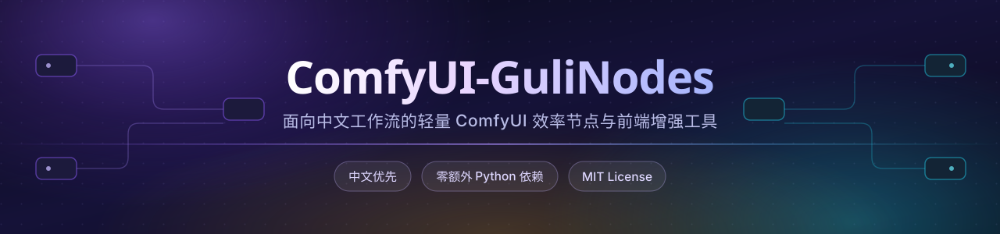

<p align="center">
  <picture>
    <source media="(prefers-color-scheme: dark)" srcset="assets/banner-dark.svg">
    <source media="(prefers-color-scheme: light)" srcset="assets/banner-light.svg">
    
  </picture>
</p>

<p align="center">
  <b>面向中文工作流的轻量 ComfyUI 效率节点与前端增强工具</b><br>
  <sub>画布整理 · 图像处理 · Latent 尺寸 · 文本输入 · 模型与 LoRA · 采样 · 视频 · 显存清理</sub>
</p>

<p align="center">
  <a href="https://github.com/guliacer/ComfyUI-GuliNodes"></a>
  <a href="https://github.com/guliacer/ComfyUI-GuliNodes/releases"></a>
  <a href="https://github.com/guliacer/ComfyUI-GuliNodes/blob/main/LICENSE"></a>
  
  
</p>

<p align="center">
  <a href="#特性亮点">特性亮点</a> ·
  <a href="#快速开始">快速开始</a> ·
  <a href="#主要能力">主要能力</a> ·
  <a href="#节点清单">节点清单</a> ·
  <a href="#依赖与兼容">依赖与兼容</a> ·
  <a href="#界面与设置">界面与设置</a> ·
  <a href="#常见问题">常见问题</a> ·
  <a href="#更新记录">更新记录</a> ·
  <a href="#致谢与借鉴说明">致谢与借鉴说明</a> ·
  <a href="#贡献">贡献</a> ·
  <a href="#许可证">许可证</a>
</p>

---

## 特性亮点

ComfyUI-GuliNodes 是一组面向中文工作流的轻量效率节点和前端增强工具，覆盖画布整理、文本输入、数值计算、图像处理、Latent 尺寸、模型/LoRA 管理、采样、视频处理、显存清理和网页 AI 辅助。**零额外 Python 依赖**，放进 `custom_nodes` 就能用。

| | 亮点 | 说明 |
| :--: | --- | --- |
| 🧩 | **参数按需显示** | 节点只展示当前选择下真正生效的输入与输出，不生效的参数直接隐藏，不做摆设。 |
| 🎨 | **画布增强** | 上色、对齐、等宽等高、自动间距、批量整理，分组可折叠为同名子工作流小节点。 |
| ⚡ | **轻量无依赖** | 只用 ComfyUI 环境自带的 `torch` / `PIL` / `numpy`，不引入 `cv2`、`kornia` 等重包。 |
| 🈶 | **中文优先** | 节点名、参数、选项、错误提示全中文，分类收敛为单级菜单，开箱即用。 |
| 🎬 | **视频与显存** | 视频加载 / 路径加载 / 合成 / 压缩 / 保存，模型与显存一键清理并输出报告。 |
| 🤖 | **AI 辅助** | 内置 Qwen Image 2.1 提示词增强与条件编码，支持内嵌网页 AI 平台反向读图。 |

---

## 快速开始

### 第 1 步 · 安装

| 方式 | 操作 |
| --- | --- |
| **ComfyUI Manager**（推荐） | 在 Manager 中搜索 `ComfyUI-GuliNodes`，点击 Install，然后重启 ComfyUI。 |
| **手动安装** | 在 `ComfyUI/custom_nodes` 下执行下面的命令。 |

```bash
cd ComfyUI/custom_nodes
git clone https://github.com/guliacer/ComfyUI-GuliNodes.git
cd ComfyUI-GuliNodes
pip install -r requirements.txt
```

> **说明**：`requirements.txt` 当前只是兼容声明，主插件没有额外 Python 包依赖。

### 第 2 步 · 重启 ComfyUI

重启后前端扩展会随插件自动加载。如果界面还是旧样子，请强制刷新浏览器（`Ctrl` + `F5`）。

### 第 3 步 · 开始使用

在画布空白处右键 → **新建节点** → 找到 **GG** 或 **GuliNodes** 分类，即可看到全部节点。

首次使用建议先打开 **设置 → GuliNodes**，或点击画布顶部的 **GuliNodes 工具** 按钮，看一眼各功能开关。

---

## 主要能力

### 画布与前端工具

- **顶部工具栏** — 节点/分组上色、取色粘贴、节点尺寸复制粘贴、对齐、等宽等高、自动间距、批量整理。
- **节点标题栏按钮** — 可分别开启「输入输出列表隐藏」与「节点折叠/恢复」按钮，状态随工作流持久化。
- **节点端口显示** — 隐藏端口只影响画布显示，不会断开已有连接，切换工作流或重开画布后继续保留。
- **参数按需显示** — 只展示当前选择下真正生效的输入与输出，不生效的参数与端口直接隐藏；`GG 图像对比 N张` 的图像槽位随连接自动增减，最多 20 张。
- **插件名称显示** — 可自动隐藏节点右上角的插件徽章，选中、点击或悬浮节点时恢复显示。
- **节点外部光效** — 选中节点与正在执行的节点会向外扩散粒子光效，支持多档强度、效果池与 9 种色彩主题。
- **连线样式** — 颜色、宽度、透明度、发光和流动效果可调，内置「虚空」等样式。
- **完成通知** — 工作流成功执行后自动通知本机 TapRelay，默认开启。
- **发送到素言** — 把出图、图像对比与关联提示词推送到素言素材库，默认隐藏，需在设置中开启。
- **标题与分组** — 画布标题/分区标注；分组可新建、改名、四边缩放、整组跳过，也可折叠为同名子工作流小节点。
- **移动对齐吸附** — 拖动节点时自动吸附到邻近节点的边缘，手感接近 PS 移动图层。
- **文本与输入体验** — 文本复制展示、密钥输入、剪贴板导入、模型列表获取、种子生成、整数输入、选项确认、数学表达式、CLIP 文本编码与 Qwen Image 2.1 提示词增强。

<details>
<summary><b>展开细节：工具栏 / 标题栏按钮 / 光效 / 连线 / 素言联动 / 分组增强</b></summary>

**顶部工具栏**
节点/分组上色、取色粘贴、节点尺寸复制粘贴、对齐、等宽等高、自动间距、批量整理；画布顶部的 GuliNodes 工具入口采用一级功能列表，普通开关在一级直接切换，连接线和节点光效等需要配置的功能才展开菜单内详细设置；菜单从工具按钮正下方打开并按实际内容收紧宽度，释放模型与深度清理合并为画布外独立按钮，不会被工具菜单收纳。

**节点标题栏按钮**
可分别开启“输入输出列表隐藏”和“节点折叠”按钮；展开节点显示折叠按钮和端口列表按钮，折叠后只保留最右侧的恢复按钮。两种状态均写入工作流节点数据，切换工作流或重新打开画布后继续保留；按钮悬浮提示对应按钮功能，不会复用节点说明提示。

**节点端口显示**
可在设置或画布顶部按钮中开启节点输入输出列表隐藏功能，并通过节点标题栏按钮切换显示；隐藏只影响画布显示，不会断开已有连接；隐藏端口后会按可见控件重新布局并锁定紧凑高度，减少节点高度反复变化。

**参数按需显示**
节点只展示当前选择下真正生效的输入与输出端口，不生效的参数和端口直接隐藏，避免误导。覆盖 `GG Latent`（Latent方式）、`GG 图像裁剪`（模式）、`GG 视频压缩`（分辨率处理）、`GG 种子生成器`（偏移模式）、`GG 图像压缩保存`（PNG 格式）、`GG 网页AI图像反推`（平台）、`GG 文本反推`（是否连接本地模型）、`GG LoRA自定义加载`（LoRA数量）、`GG 提示词增强qwen2.1`（任务模式/增强方式）等节点；`GG 图像对比 N张` 默认显示一个图像槽位，连接后自动增加下一个，最多 20 张，标签控件随已连接图像源同步增减。

**节点插件名称显示**
可在设置或画布顶部按钮中开启自动隐藏节点右上角插件徽章；选中、点击或悬浮节点时恢复显示，折叠节点同样适用。

**节点外部光效**
可在设置或画布顶部 GuliNodes 工具菜单中开启；用户选中的节点和工作流当前执行节点会显示外部光效，支持智能、自定义、随机、低/标准/梦幻/沉浸强度及多种光效效果池；光效设置可直接从画布按钮打开。效果只有光、没有光环——不画任何描边几何，粒子直接生成在节点边界并向外随机扩散，扩散范围对齐参考实现的 76px 扩散带并随强度缩放，粒子按节点独立的随机序列生成、同节点同效果的两次会话排布不同，也不额外叠加背景图层。光效配色跟随画布明暗主题切换，浅色主题使用高饱和深色，深色主题使用浅亮色，避免同色相在背景上糊成一片。

**连线样式**
颜色、宽度、透明度、发光和流动效果可调；新增“虚空”样式，只在输入输出端保留短提示段并隐藏中间路径。

**完成通知**
工作流成功执行后，可通过本机同源后端适配自动通知 TapRelay，默认开启，并可在设置页或顶部铃铛按钮中关闭。

**发送到素言**
画布顶部独立的「发送到素言」图标按钮（保持在 GuliNodes 工具菜单外部，使用素言应用图标），默认隐藏，需在 设置 → GuliNodes → 素言联动 中开启后显示。将非跳过状态的图像保存节点（最新一张）、图像对比节点（最新一组）与关联正面提示词推送到素言本地收件服务（`http://127.0.0.1:9477`），落入素言素材库；提示词按“执行完成后的服务端 `/history/{prompt_id}` → 队列/执行开始时的前端快照 → 图片内嵌元数据”顺序回退，沿采样器图像血缘和正面 Conditioning 分支追踪，支持 `easy positive`、开关节点和中间文本链，避免读取已连接 CLIP 节点残留的旧文本；图片按提示词分组，提示词相同的图片归入同一提示词组。

**标题节点**
画布标题和分区标注。

**组增强**
选中节点可直接新建为组，组名可改，标题随画布缩放保持清晰，支持四角和四边缘拖拽缩放；可在标题栏快速显示/隐藏整组以跳过组内节点，也可将分组折叠为同名子工作流小节点；折叠时保留组内节点原始布局并只显示代理小节点，支持拖动和双击改名，通过右下角彩色圆点或顶部快捷开关按快照还原原始位置和尺寸。

**移动对齐吸附**
拖动节点时自动对齐到附近节点的左/中/右、上/中/下边缘（像 PS 移动图层），命中时显示红色参考线并磁吸；可在设置或顶部工具菜单「移动对齐」开关中启用/关闭。

**文本与输入体验**
文本复制展示、密钥输入、端点/模型/密钥剪贴板粘贴与 API 配置快速导入、端点网址自动提取适配、按端点和密钥获取模型列表、种子生成、整数输入、选项确认、简单数学表达式、CLIP 文本编码和 Qwen Image 2.1 图像提示词增强一体化。

</details>

### 图像与 Latent

- **基础图像处理** — 尺寸调整、裁剪、翻转旋转、亮度/对比度/饱和度/锐化/虚化、色彩校正。
- **风格参考** — 使用纯 PyTorch 统计迁移和纹理混合实现，不依赖 OpenCV。
- **图像保存与压缩** — 预览、保存、压缩保存、独立压缩，支持 JPEG/PNG/WEBP。
- **图像对比** — 2 图和最多 20 图拼接预览，适合参数对比和 A/B 测试。
- **Latent 尺寸** — `GG Latent` 支持按边长、按 K 数分辨率、按 Latent 接入、按图像接入四种生成方式；按边长用边长与边长类型做自定义尺寸，按 K 数分辨率含 1K–4K 档位，另有输入尺寸倍率缩放、图像缩放方法与尺寸读取；另提供 Latent 缩放、VAE 编码/解码缓存。

### 模型、LoRA、采样与视频

- **LoRA** — 20 槽自定义 LoRA 叠加。
- **模型加载** — VAE 缓存编码/解码。
- **采样** — Z-Image 采样器。
- **显存清理** — 卸载 ComfyUI 模型、清理设备缓存、清理 GuliNodes VAE 缓存并输出报告。
- **视频** — 视频加载、路径加载、图像音频合成视频、压缩、保存。

---

## 节点清单

当前版本实际注册 37 个节点。

### 图像、尺寸与 Latent

| 节点 | 用途 |
| --- | --- |
| `GG 图像宽高` | 支持按边长、按 K 数分辨率、按 Latent 接入、按图像接入四种方式，输出对齐到 8 的宽度/高度。 |
| `GG Latent` | 支持按边长、按 K 数分辨率、按 Latent 接入、按图像接入；输入 Latent/图像时可按倍率调整输出尺寸。 |
| `GG 图像缩放` | 输入 IMAGE 后自动读取宽高，按缩放方法和倍率缩放，仅输出缩放后的图像。 |
| `GG VAE解码` | 加载并缓存 VAE 后解码 Latent。 |

### 图像处理与输出

| 节点 | 用途 |
| --- | --- |
| `GG 图像裁剪` | 中心、坐标、比例等裁剪。 |
| `GG 图像变换` | 水平/垂直翻转和 90/180/270 度旋转。 |
| `GG 图像调整` | 亮度、对比度、饱和度、锐化和虚化。 |
| `GG 色彩校正` | 使用 torch 张量批量调整温度、色调、明度、对比度、饱和度和伽马。 |
| `GG 风格参考` | 参考图像风格统计迁移和纹理混合。 |
| `GG 图像预览` | 预览图像。 |
| `GG 图像保存` | 保存图像。 |
| `GG 图像压缩保存` | 压缩并保存图像，支持保存完成后清理模型、设备缓存、Python GC 和 GuliNodes VAE 缓存。 |
| `GG 图像压缩` | 输出压缩后的图像。 |
| `GG 图像对比 2张` | 双图对比预览。 |
| `GG 图像对比 N张` | 默认一个图像输入，连接后自动增加下一个，最多 20 张；标签只显示已连接图像源，断开后自动收起。 |

### 文本、输入与工作流组织

| 节点 | 用途 |
| --- | --- |
| `GG 文本` | 显示文本并支持前端复制。 |
| `GG TXT加载` | 像加载图像一样选择或上传 TXT/MD 文本文件，并输出文本内容。 |
| `GG CLIP文本` | 加载 CLIP 并编码文本。 |
| `GG 密钥输入` | 用于 API Key、令牌、API 端点和模型名称，可测试当前配置、按端点和密钥获取模型列表并确认选择；支持单字段粘贴和一次导入端点/API Key/模型，能够识别 JSON、curl、带标签文本并自动提取与适配端点网址；同时输出兼容 JSON `API配置`，以及可分别连接下游 `api_key`、`api_base_url`、`model` 的独立字符串端口。 |
| `GG 提示词增强qwen2.1` | 按 Qwen Image 2.1 官方规则把需求改写成高质量提示词，输出 `增强提示词` 文本。任务模式分文生图/图生图；增强方式支持 API、本地PE（官方 PE safetensors）、本地LLM（GGUF+mmproj，需可选依赖 llama-cpp-python）。图生图可接最多 20 张参考图，文生图无需图像。 |
| `GG 提示词优化qwen2.1` | 把 CLIP、VAE、正/负提示词和最多 20 张参考图整合到一个 Qwen Image 2.1 条件编码节点，输出 `正面条件`、`负面条件`。参考图按 `分辨率` 缩放对齐后由 VAE 编码进 Conditioning 的 `reference_latents`；未接参考图时前端隐藏 `VAE名称` 与 `分辨率`。 |
| `GG 整数` | 输入自定义整数并原样输出整数。 |
| `GG 选项确认` | 连接到任意节点的可选控件后，在本节点同步生成对应选项；最多支持 20 个输出源。前端虚拟节点，不计入后端注册数量。 |
| `GG 简单数学表达式` | 使用 `a`、`b`、`c`、`d` 四个输入执行简单表达式计算，并输出两组整数/浮点结果。 |
| `GG 种子生成器` | 生成或固定随机种子。 |
| `GG 标题` | 画布标题和分区标注。 |
| `GG 多组控制` | 批量控制工作流中所有编组：一键全部跳过/全部启用，列出每个组的节点数与跳过/启用/部分跳过状态，点击组名可跳转到该组。 |
| `GG 单组控制` | 精确控制单个编组：点击下拉框选择目标组，开关一键跳过/启用该组内节点。 |
| `GG 网页AI图像反推` | 在节点中打开豆包、腾讯元宝、文心一言或自定义网页。 |
| `GG 文本反推` | 调用大模型按规则提取小说内容并总结，支持文本或 TXT 输入。 |

### 模型、LoRA、采样与显存

| 节点 | 用途 |
| --- | --- |
| `GG LoRA自定义加载` | 最多 20 槽 LoRA 自定义叠加。 |
| `GG 内存清理` | 卸载模型、清理缓存并输出报告；画布外清理按钮会执行同等的全量清理。 |
| `GG Z-Image采样器` | Z-Image 专用采样。 |

### 视频

| 节点 | 用途 |
| --- | --- |
| `GG 视频加载` | 从 input/temp/output 目录或文件路径加载视频并预览。 |
| `GG 视频路径加载` | 通过本机真实文件路径加载视频，不经过浏览器上传，适合超过 ComfyUI 上传限制的大视频。 |
| `GG 视频合成` | 将上游 IMAGE 批次与 AUDIO 合成为 VIDEO，支持视频格式、像素格式、CRF、输出帧率和音频修剪，便于接入 `GG 视频压缩`。 |
| `GG 视频压缩` | 使用 ffmpeg 压缩视频并显示进度。 |
| `GG 视频保存` | 保存或封装视频输出。 |

---

## 依赖与兼容

主插件保持**零额外 Python 依赖**：不需要安装 `cv2`、`mediapipe`、`color-matcher`、`kornia` 等额外包。部分功能会调用外部程序或可选插件，例如视频处理需要系统可调用 `ffmpeg`。

| 功能 | 依赖 | 说明 |
| --- | --- | --- |
| 主插件节点 | 无额外 Python 包 | 仅依赖 ComfyUI 自带 Python 环境中的常规库。 |
| `GG 密钥输入` 模型获取 | Python 标准库 `urllib` + 服务商兼容的 `/models` 接口 | 支持常见 OpenAI 兼容模型列表响应；不增加额外 Python 依赖。浏览器剪贴板粘贴需要 ComfyUI 页面允许读取剪贴板。 |
| 图像处理 | ComfyUI 环境内的 `torch`、`PIL`、`numpy` | 不需要 `cv2`、`mediapipe`、`kornia` 或 `color-matcher`。 |
| 发送到素言 | ComfyUI 前端 API + 素言本地收件服务 | 需要素言监听 `http://127.0.0.1:9477/guli/suyan/import`；提示词按服务端执行历史、队列快照、图片元数据顺序回退，不增加 Python 依赖。 |
| GG Latent 尺寸计算 | 无额外 Python 依赖 | 按 K 数分辨率时由后端按预设 K 数、宽高比例和画面方向直接计算尺寸，不显示边长/边长类型；按边长时才按边长和边长类型计算。 |
| 视频加载/压缩/保存 | `ffmpeg`，可选 `ffprobe` | 需要系统命令可调用，或把 ffmpeg 放到 PATH。 |
| TapRelay 完成通知 | TapRelay PC 软件（本机 `1122` 端口） | 可选功能。需要 TapRelay 正在运行；TapRelay 未启动或通知失败时只记录前端警告，不影响 ComfyUI 工作流。 |
| `GG 提示词增强qwen2.1` 本地LLM 方式 | 可选依赖 `llama-cpp-python` + GGUF 主模型（图生图另需 mmproj） | 仅「本地LLM」增强方式需要，按需手动安装（按平台/CUDA 选 wheel）；未安装时该方式给中文提示，API / 本地PE 方式不受影响。API 方式需服务商 OpenAI 兼容接口；本地PE 方式用 ComfyUI 文本编码器栈加载官方 PE safetensors（models/text_encoders）。 |
| ComfyUI Nodes 2.0 | ComfyUI 前端的 `Nodes 2.0` 开关 | 已适配标题 DOM 工具栏、分组折叠隐藏、节点/分组选择状态、上色显示和 `GG 图像对比` DOM 预览；关闭 Nodes 2.0 时继续使用原有 Canvas 路径。 |

**推荐模型目录**

| 资源类型 | 推荐目录 |
| --- | --- |
| VAE | `ComfyUI/models/vae/` |
| CLIP / text encoder | `ComfyUI/models/text_encoders/` |
| LoRA | `ComfyUI/models/loras/` |

---

## 界面与设置

所有开关改完立即生效、无需重启。入口有三处：

| 入口 | 位置 | 适用 |
| --- | --- | --- |
| 设置页 | **设置 → `GuliNodes`**，含「节点显示」「TapRelay」「素言联动」等分组 | 全部开关与配置 |
| 画布顶部 | **GuliNodes 工具** 按钮 | 日常高频开关 |
| 节点标题栏 | 节点右上角的折叠 / 输入输出列表按钮 | 单个节点 |

常用开关注释：

| 开关 | 作用 | 备注 |
| --- | --- | --- |
| 节点光效 | 选中与执行节点显示外部粒子光效 | 强度、效果池、配色可在同处设置 |
| 连线样式 | 连接线颜色、宽度、透明度、发光与流动 | 含「虚空」等样式 |
| 界面翻译 | 前端界面中文化 | — |
| 分组样式 | 接管官方 Group 绘制与交互 | 启用后分组支持折叠为子工作流 |
| 输入输出列表 | 隐藏节点端口列表，只影响显示 | 状态写入节点数据 |
| 节点折叠 | 标题栏折叠/恢复按钮 | 折叠宽度可调（60–400，默认 150） |
| 移动对齐吸附 | 拖动节点时吸附到邻近节点边缘 | 默认开启 |
| 完成通知 | 执行完成后通知 TapRelay | 默认开启，需 TapRelay 在运行 |
| 素言联动 | 显示「发送到素言」按钮 | 默认关闭 |

---

## 常见问题

### 安装时还需要 `pip install -r requirements.txt` 吗？

可以执行，但当前文件不安装额外包，只用于兼容 ComfyUI Manager 或已有安装习惯。

### 视频加载或压缩失败怎么办？

确认 `ffmpeg` 可以在系统 PATH 中直接运行。大视频可以使用 `GG 视频路径加载` 直接选择本机文件路径，避免浏览器上传大小限制；也可以放入 `ComfyUI/input` 后在节点里选择。

### 网页 AI 节点无法嵌入？

部分平台会限制 iframe 嵌入。可以尝试自定义移动端地址，或在外部浏览器打开平台网页使用。

### TapRelay 没有收到 ComfyUI 完成通知？

确认 TapRelay PC 软件正在运行并监听 `1122` 端口，然后在 ComfyUI 设置的 `GuliNodes / TapRelay` 中，或点击顶部铃铛按钮，确认“ComfyUI 完成后通知 TapRelay”已开启。通知由 GuliNodes 后端转发到 `http://127.0.0.1:1122/send`，TapRelay 不可用时不会阻断工作流。

---

## 更新记录

### v1.1.1

- 彻底修复 `GG 提示词优化qwen2.1` 高度只能拉高、无法压低的问题：此前前端给节点装了「记住手动高度」的 `computeSize`/`onResize` 补丁，一旦触发就把节点最小高度锁死在当前高度，形成「只增不减」的棘轮。现移除这套补丁，改为对齐官方 `Text Encode Qwen Image 2.1` 的做法——节点最小高度完全交回原生 `computeSize`，多行框随节点缩放滚动，可自由拉高或压低。切换「VAE名称」「分辨率」显隐时只按内容把节点撑大、绝不主动压低，不再与用户手动高度打架。

### v1.1.0

自 GitHub 公开版本 v1.0.13 以来的累积更新，按主题精简汇总。

**新增节点**

- `GG 提示词增强qwen2.1`：按 Qwen Image 2.1 官方规则把需求改写成高质量提示词，支持 文生图/图生图 与 API / 本地PE / 本地LLM 三档增强方式。
- `GG 提示词优化qwen2.1`：把 CLIP、VAE、正/负提示词和最多 20 张参考图整合为单个 Qwen Image 2.1 条件编码节点。
- 回归 `GG 多组控制`、`GG 单组控制`；新增 `GG 整数`、`GG 选项确认`。

**节点重构与增强**

- `GG Latent`、`GG 图像宽高`：统一四种接入方式（按边长、按 K 数分辨率、按 Latent 接入、按图像接入），1K–4K 档位按最长边计算。
- `GG 图像缩放`：改为 IMAGE 输入自动读取宽高，输出端口始终稳定显示（修复历史版本输出端口丢失）。
- `GG 图像对比`：升级为 N 张拼接（最多 20），标签随连接同步增减，兼容 RGBA 输入。
- `GG 图像裁剪`：新增按比例、按 K 数分辨率模式。
- `GG 密钥输入`：一键获取模型列表、剪贴板快速导入端点/密钥/模型、独立字符串输出。
- 精简重复与低频节点，节点分类收敛为单级菜单。

**画布与前端体验**

- 顶部 GuliNodes 工具菜单重做：普通开关一级直切，高级设置内嵌，按内容收紧宽度。
- 节点标题栏工具：输入输出列表隐藏、折叠/恢复、固定按钮，状态随工作流持久化。
- 节点外部光效：多档强度 + 9 色主题，粒子随机向外扩散、配色跟随画布明暗。
- 连接线样式：新增 虚空 / 极光 / 双螺旋 / 波涛 / 星河，修复“时有时无”与子图连线不显示。
- 分组增强：子工作流折叠、右下角圆点恢复、跳过语义对齐官方 Bypass、适配 Nodes 2.0。
- 新增移动对齐吸附、节点插件名称自动隐藏，界面翻译与工具栏图标体系统一美化。
- 新增“发送到素言”联动与图像元数据内嵌（PNG/JPEG/WEBP），完善提示词溯源。

**稳定性**

- 系统性修复含多行文本框节点“高度只增不减”、隐藏端口后布局漂移的问题。
- 新增连接线绘制自愈看门狗，优化拖动画布/节点期间的绘制性能。

<details>
<summary>历史版本记录（点击展开）</summary>

### v1.0.13

- 修复 `GG 图像缩放` 在 BHWC 图像上的宽高索引错误、新版 `NodeOutput` 返回不兼容和“分块VAE”开关未生效问题，以及图像对比节点的空输入、稀疏输入标签错位和输出缺失问题。
- 收紧 TXT 文件选择的目录边界，防止 `TXT文件` 绕过 ComfyUI `input` 目录；`TXT路径` 仍支持显式本机路径。
- 修复 API 地址缺少协议时无法请求、仅填写模型名被误判为 API 配置的问题。
- LoRA 加载或应用失败时改为返回包含文件名和处理建议的错误，不再静默跳过。
- 视频临时/保存文件名增加唯一后缀，避免同秒任务互相覆盖；修复 AVI 回退转码使用无效质量参数的问题。

### v1.0.12

- 移除一批节点，精简插件体积和分类：`GG GGUF模型`、`GG UNET模型`、`GG DyPE动态位置`、`GG LoRA选择 4个`、`GG LoRA选择 8个`、`GG 全局转接`、`GG 转接`、`GG Set`、`GG Get`、`GG RGBA转RGB`、`GG 数值`、`GG 浮点滑条`、`GG 万能滑条`、`GG 绘制蒙版`、`GG 图像CAS锐化+`、`GG 单组控制`、`GG 多组控制`。
- 移除上述节点对应的前端扩展文件（转接、Set/Get、万能滑条、分组控制等）。
- 保留 `GG LoRA自定义加载`（20 槽 LoRA 叠加）、`GG 简单数学表达式`、VAE 缓存编码/解码、内存清理、视频、网页 AI 等节点。
- 当前实际注册节点数由 58 调整为 41。

### v1.0.11

- 新增 ComfyUI 完成后 TapRelay 通知适配：监听工作流成功完成事件，发送完成状态、任务 ID 和耗时；支持在 GuliNodes 设置页和顶部铃铛按钮中关闭。
- 新增 `GG 简单数学表达式` 节点：支持 `a`、`b`、`c`、`d` 四个输入和两条表达式，输出两组整数/浮点计算结果，可用于宽高、倍率、步长等简单参数换算。
- `GG 简单数学` 更名为 `GG 简单数学表达式`，节点 ID `GGSimpleMath` 保持不变以兼容已有工作流。
- 顶部工具栏：新增上色取色/粘贴功能，可从画布节点或分组复制上色信息，并粘贴到单个/多个选中节点或分组。
- 顶部工具栏：新增节点尺寸复制/粘贴功能，可把一个节点的宽高应用到单个或多个选中节点。
- 分组样式增强：修复四边四角拖拽缩放的事件捕获顺序，并兼容新版 LiteGraph 分组矩形写回。
- 分组样式增强：新增标题栏缩放折叠按钮和顶部快捷开关，折叠时会保存分组框与组内节点的位置/尺寸快照，将分组显示为官方风格的同名子工作流小节点，恢复时精确写回原始布局，并过滤隐藏节点绘制、命中、文本和连线显示。
- 分组样式增强：修复工作流在分组折叠为子工作流小节点时保存，重新打开后组内节点以折叠坐标直接显示并重叠的问题。
- 分组样式增强：启用后会强制接管官方 Group 绘制、鼠标交互和分组选择工具条，避免官方分组按钮与 GuliNodes 分组功能叠加显示。
- 分组样式增强：新增浏览器本地缓存记忆，重启 ComfyUI 后会按工作流和组内节点快照恢复折叠子工作流状态；超过缓存期限的折叠工作流会自动恢复到折叠前布局，避免节点重叠。
- 分组样式增强：折叠父组时会同步归纳内部子组，保存或重启后不会残留未缩放的子组空框。
- 分组样式增强：修复折叠内层组时把外层组误判为子组的问题；现在折叠内层组只收起内层内容，折叠外层组才会同步收起内部子组和组内节点。
- 分组样式增强：折叠小节点单击不再恢复；支持拖动当前折叠位置且不改变原始快照位置，双击可自定义显示名称。
- 分组样式增强：新增画布右下角子工作流圆点指示器，多个折叠分组会自动排列并分配随机颜色；悬停显示名称，点击可恢复对应分组。
- 分组样式增强：右下角子工作流圆点按当前工作流隔离，切换工作流时会立即隐藏其他工作流的圆点，避免误点恢复旧工作流导致重叠。
- 新增 `GG 视频路径加载` 节点：通过本机路径直接加载视频，不经过浏览器上传，适合绕开 ComfyUI 上传体积限制。
- 新增 `GG 视频合成` 节点：把上游 `IMAGE` 批次和 `AUDIO` 合成为 `VIDEO`，作为 `GG 视频压缩` 的前置桥接节点，方便接入没有视频输出的第三方工作流。
- `GG 视频合成` 支持视频格式、像素格式、CRF、输出帧率和修剪音频参数；修剪音频会按当前输出帧率计算视频时长。
- `GG 视频路径加载` 增加前端“选择视频文件”按钮，使用 Windows 原生文件选择器填写真实路径。
- 修正新增视频节点分类，统一归入 `GuliNodes/视频`。

### v1.0.10

- 主插件与额外 Python 依赖解耦，保留零额外 Python 依赖安装体验。
- 当前实际注册 56 个节点。
- 新增 `GG 色彩校正` 节点，基于 ColorCorrect 功能用 torch 张量批量实现，无需额外 OpenCV 依赖。
- 保留 GGUF、DyPE、Z-Image、视频、前端工具栏、Set/Get、标题、转接、内存清理等节点。
- 移除需要额外 Python 包的节点代码，例如 `color-matcher` / `kornia` 色彩匹配、`llama-cpp-python` 图像提示词和提示词优化相关节点。
- 恢复零额外 Python 依赖的网页 AI 节点和风格参考节点。

### 历史版本

- v1.0.9：参数中文化、文本框悬浮按钮、CLIP 编码简化。
- v1.0.8：前端工具栏和交互能力优化。
- v1.0.6：新增网页 AI 图像反推节点。
- v1.0.5：视频加载、压缩、保存节点上线。

</details>

---

## 致谢与借鉴说明

本项目会尽量把借鉴、适配和桥接关系写清楚。除下表列出的项目外，其余节点主要是围绕 ComfyUI 原生节点 API、前端扩展 API 和日常中文工作流需求重新实现；如后续发现遗漏来源，会继续补充。

> **强制规则（不可省略）**
> 1. **只要借鉴或参考了任何外部项目**（桥接 / 适配 / 思路参考 / 算法思路），都必须在本处的致谢表里补上一行，写明来源名称 + 项目地址（URL）+ 实际参考的节点或功能，缺 URL 或缺引用关系都算不合规。
> 2. **删除节点或功能时，对应致谢行不删除文本**，只用删除线（`~~……~~`）标注失效，保留来源记录，防止致谢信息随功能一起消失。

| 涉及功能/节点 | 致谢对象 | 说明 |
| --- | --- | --- |
| 全部节点与前端工具 | ComfyUI、ComfyUI_frontend、LiteGraph | 本项目运行在 ComfyUI 自定义节点和前端扩展机制之上，画布、节点、连线、分组绘制等能力依赖这些基础 API；Nodes 2.0 适配遵循官方 Vue DOM 节点由前端负责布局、LiteGraph 继续负责画布分组与连线的边界。 |
| 节点外部光效 | `W:\提示词`“视觉生命”卡片外部光效 | 参考其边缘柔光、粒子效果池和效果模式的交互思路；配色参考其 `light_theme` 分支（浅色主题改用高饱和深色、深色主题用浅亮色）；扩散范围沿用其 `EFFECT_BLEED`（76px）扩散带与逐效果参数表（粒子数量上限、生命周期、半径、速度），粒子生成沿用其「按边随机取点 → 向外位移 → 随机相位/速度/生命周期」模型与线性同余随机序列；GuliNodes 按 ComfyUI LiteGraph 的节点局部坐标绘制并随画布缩放换算，去掉其独立叠加画布与内部擦除做法，未复制其源码。 |
| 节点插件名称自动隐藏 | ComfyUI_frontend、LiteGraph 官方节点徽章 API | 通过官方 `drawBadges` 绘制入口和 Nodes 2.0 节点徽章 DOM 做显示层适配，不修改节点数据或工作流序列化。 |
| `GG 色彩校正` | ColorCorrect 类色彩校正功能 | 参数设计和功能目标参考 ColorCorrect 的温度、色调、明度、对比度、饱和度、伽马调节思路；当前实现改写为 torch 张量批处理，不依赖额外 OpenCV/kornia 包。 |
| `GG 图像压缩保存`、`GG 图像压缩` | [civilblur/mazanoke](https://github.com/civilblur/mazanoke)、[Lymphatus/caesium-image-compressor](https://github.com/Lymphatus/caesium-image-compressor)、[meowtec/Imagine](https://github.com/meowtec/Imagine) | 三档压缩模式（civilblur / Caesium / meowtec）的命名与「按质量或目标大小压缩 JPEG/PNG/WEBP」的功能形态分别受这三个开源图像压缩工具启发；GuliNodes 用 ComfyUI 环境自带的 Pillow 重新实现（optimize/progressive/subsampling、WEBP method=6、目标大小二分搜索质量），不调用也不内置这些项目的源码。 |
| `GG 图像对比 2张` | ComfyUI-KJNodes、[ComfyUI_JosiaNodes](https://github.com/Josia-doit/ComfyUI_JosiaNodes) | 双图对比节点的交互形态和使用场景参考了 KJNodes 与 JosiaNodes 的相关实现；本项目按 GuliNodes 的预览、保存和前端交互方式重新整理。 |
| 文本框悬浮按钮 | [ComfyUI-Prompt-Assistant](https://github.com/yawiii/ComfyUI-Prompt-Assistant) | 文本框悬浮复制、粘贴、清空按钮的交互灵感来源于 Prompt Assistant；本项目按 GuliNodes 的全局文本框识别、设置开关和前端按钮样式重新实现。 |
| `GG 标题` | rgthree、Anything Everywhere、Reroute 等社区常见工作流形态 | 这些节点借鉴了社区里“画布标注”的交互思路，但前后端逻辑按 GuliNodes 的中文体验和序列化方式重写。 |
| `GG 简单数学表达式` | ComfyUI_essentials 的 SimpleMathDual+ 节点形态 | 节点输入结构和常用表达式场景参考 SimpleMathDual+；当前实现按 GuliNodes 中文命名重新实现，并使用 AST 白名单求值避免直接执行任意代码。 |
| `GG 提示词增强qwen2.1` | TE MAN / QQ / Wysl 的「Qwen Image 2.1 AI提示词增强」节点、Qwen Image 2.1 官方提示词改写规则 | 提示词增强 API 与本地官方 PE 通路的逻辑、以及官方 system prompt 模板（`guli_nodes/qwen_pe_prompts.py`）整段移植自 TE MAN / QQ 的同类节点；本项目按 GuliNodes 命名与结构重写为文生图/图生图两档任务、API/本地PE/本地LLM 三档增强方式、参考图 Autogrow 最多 20 张，并去掉思考模式与最大边长设置。本地LLM 通路（llama-cpp-python 加载 GGUF + mmproj）为本项目按用户要求新增实现。 |
| `GG 选项确认` | Wysl-MultiPrimitive | 下游控件规格识别、动态输出端口和选项同步的交互思路参考该节点；当前实现按 GuliNodes 的中文节点命名、单输出初始状态和最多 20 个输出源重新实现。 |
| `GG 提示词优化qwen2.1` | ComfyUI 原生 `Text Encode Qwen Image 2.1`（TextEncodeQwenImageEditPlus） | 适配：把原生的 CLIP 文本编码、VAE 参考图编码与 `reference_latents` 逻辑整合进单个节点，按 GuliNodes 中文命名重写，参考图改用 Autogrow 最多 20 张，去掉 Latent 输出，仅保留供 Conditioning 使用的 VAE 选项。 |
| `GG Latent` 分辨率档位 | 常见数字影像/电影制作 K 分辨率约定 | 1K/2K/3K/4K 分别以最长边 1024/2048/3072/4096 像素为基准，另一边按宽高比例和画面方向计算并对齐到 8。 |
| 分组前端增强 | [Josia-doit/ComfyUI_JosiaNodes](https://github.com/Josia-doit/ComfyUI_JosiaNodes)、ComfyUI 原生 Group 与社区分组管理/样式插件 | 标题栏显示/隐藏按钮和组内节点识别机制沿用本项目之前单组/多组控制节点的思路；当前跳过操作直接使用官方分组菜单的 `mode=4` Bypass 语义，保存并恢复每个节点原有模式，不改写用户设置的 `mode=2` Never。子工作流折叠为本项目前端交互增强，会保存组内节点位置和尺寸快照，仅影响分组内节点的画布显示与命中，并提供可拖动/改名的画布折叠小节点和右下角圆点恢复入口；组查找严格限定当前 LiteGraph 图，避免根图子图注册表串组，隐藏时不再把节点压缩到同一位置。 |
| `GG 多组控制`、`GG 单组控制` | [rgthree-comfy](https://github.com/rgthree/rgthree-comfy) 的 Fast Groups Bypasser | 编组批量/单组跳过启用的交互思路参考该节点；跳过与启用的模式语义与其对齐（Bypass `mode=4` / `ALWAYS` `mode=0`），组内节点识别与整体绘制、命中、跳转按 GuliNodes 独立实现。 |
| `GG 视频加载`、`GG 视频路径加载`、`GG 视频合成`、`GG 视频压缩`、`GG 视频保存` | ffmpeg/ffprobe 与 ComfyUI 视频工作流生态 | 视频封装、压缩和探测依赖 ffmpeg/ffprobe；节点形态面向 ComfyUI 常见 IMAGE/AUDIO/VIDEO 串联工作流重新封装。 |
| `GG 视频压缩` 编码器与压制形态 | [小丸工具箱 / Maruko's Toolbox](https://github.com/wzxjohn/marukotoolbox) | 编码器选项命名（`x264_64-8bit.exe`、`x265-8bit\gcc[cpu].exe` 等 8/10/12bit x264/x265 档位）与「选编码器 + 调 CRF 压制」的交互形态参考小丸工具箱；GuliNodes 内部实际由 ffmpeg（libx264/libx265）编码，不打包也不调用其二进制。 |
| `web/gg-group-styler.js` | ComfyUI-Group-Styler 的“前端扩展 + LiteGraph Group 绘制”路线 | 新增分组样式增强参考了该类前端实现路线，但没有复制其源码；当前文件在本项目内独立包装 `drawGroups`，带设置开关和原生绘制回退，并扩展标题栏按钮、顶部快捷开关、子工作流折叠动画、隐藏节点过滤与右下角圆点恢复指示器。当前图与根图子图注册表严格隔离，折叠代理只收缩外层组，组内节点保持原始位置以兼容不同 ComfyUI 绘制路径。 |
| TapRelay 完成通知 | `W:\TapRelay` 的 HTTP/WebSocket 通知协议 | 适配 TapRelay PC 端固定的 `POST http://127.0.0.1:1122/send` 接收协议，发送 `message`、`source`、`status`、`taskId` 和 `durationMs`；GuliNodes 只做协议桥接，不复制 TapRelay 的接收或广播实现。 |

---

## 贡献

欢迎通过 [Issue](https://github.com/guliacer/ComfyUI-GuliNodes/issues) 反馈问题、提出需求，或用 Pull Request 提交改进。

提交代码前建议先扫一眼 [`AGENTS.md`](AGENTS.md)：里面记录了本项目的目录落位、节点命名规范、前端扩展红线和文档同步要求，按它来能省掉大部分返工。

也特别欢迎补充「致谢与借鉴说明」——如果某个功能实际上参考了某个项目而上面没写，请直接告诉我们。

---

## 许可证

本项目基于 MIT 许可证开源，详见 [LICENSE](LICENSE)。

Copyright © 2026 Guli
